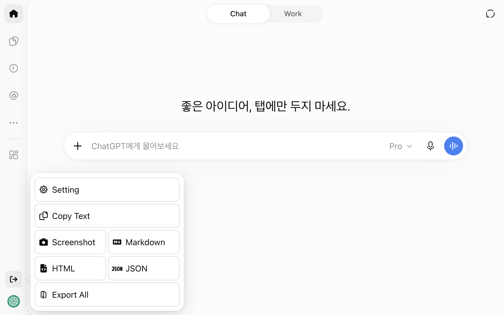

<h1 align="center">ChatGPT Exporter</h1>

## [ChatGPT](https://chatgpt.com/) 의 채팅 기록을 내보내는 GreasyFork 스크립트

[![license][license-image]][license-url]
[![release][release-image]][release-url]
[![GreasyFork][GreasyFork-image]][GreasyFork-url]

[license-image]: https://img.shields.io/github/license/pionxzh/chatgpt-exporter?color=red
[license-url]: https://github.com/pionxzh/chatgpt-exporter/blob/master/LICENSE
[release-image]: https://img.shields.io/github/v/release/pionxzh/chatgpt-exporter?color=blue
[release-url]: https://github.com/pionxzh/chatgpt-exporter/releases/latest
[GreasyFork-image]: https://img.shields.io/static/v1?label=%20&message=GreasyFork&style=flat-square&labelColor=7B0000&color=960000&logo=data:image/png;base64,iVBORw0KGgoAAAANSUhEUgAAABAAAAAQCAYAAAAf8/9hAAAABmJLR0QA/wD/AP+gvaeTAAAACXBIWXMAAAsTAAALEwEAmpwYAAAAB3RJTUUH3ggEBCQHM3fXsAAAAVdJREFUOMudkz2qwkAUhc/goBaGJBgUtBCZyj0ILkpwAW7Bws4yO3AHLiCtEFD8KVREkoiFxZzX5A2KGfN4F04zMN+ce+5c4LMUgDmANYBnrnV+plBSi+FwyHq9TgA2LQpvCiEiABwMBtzv95RSfoNEHy8DYBzHrNVqVEr9BWKcqNFoxF6vx3a7zc1mYyC73a4MogBg7vs+z+czO50OW60Wt9stK5UKp9Mpj8cjq9WqDTBHnjAdxzGQZrPJw+HA31oulzbAWgLoA0CWZVBKIY5jzGYzdLtdE9DlcrFNrY98zobqOA6TJKHW2jg4nU5sNBpFDp6mhVe5rsvVasUwDHm9Xqm15u12o+/7Hy0gD8KatOd5vN/v1FozTVN6nkchxFuI6hsAAIMg4OPxMJCXdtTbR7JJCMEgCJhlGUlyPB4XfumozInrupxMJpRSRtZlKoNYl+m/6/wDuWAjtPfsQuwAAAAASUVORK5CYII=
[GreasyFork-url]: https://greasyfork.org/scripts/456055-chatgpt-exporter

[English](./README.md) &nbsp;&nbsp;|&nbsp;&nbsp; [Français](./README_FR.md) &nbsp;&nbsp;|&nbsp;&nbsp; [Indonesia](./README_ID.md) &nbsp;&nbsp;|&nbsp;&nbsp; 한국어 &nbsp;&nbsp;|&nbsp;&nbsp; [Türkçe](./README_TR.md) &nbsp;&nbsp;|&nbsp;&nbsp; [繁體中文](./README_ZH-TW.md) &nbsp;&nbsp;|&nbsp;&nbsp; [简体中文](./README_ZH-CN.md)

<picture>
  <source media="(prefers-color-scheme: dark)" srcset="./docs/readme/hero-ko-dark.png">
  
</picture>

## 설치하기

### 사전 준비 조건

<b>`Tampermonkey`</b> 설치하기

[][link-chrome] &nbsp;&nbsp; [][link-firefox] &nbsp;&nbsp; [][link-edge]

[link-chrome]: https://chrome.google.com/webstore/detail/tampermonkey/dhdgffkkebhmkfjojejmpbldmpobfkfo 'Chrome 웹 스토어'
[link-firefox]: https://addons.mozilla.org/firefox/addon/tampermonkey 'Firefox 애드온'
[link-edge]: https://microsoftedge.microsoft.com/addons/detail/tampermonkey/iikmkjmpaadaobahmlepeloendndfphd 'Edge 애드온'

### UserScript

| Greasyfork                                                                        | GitHub                                                                                       |
| --------------------------------------------------------------------------------- | -------------------------------------------------------------------------------------------- |
| [![Install][Install-1-image]][install-1-url] | [![Install][Install-2-image]][install-2-url] |

[Install-1-image]: https://img.shields.io/badge/-Install-blue
[Install-1-url]: https://greasyfork.org/scripts/456055-chatgpt-exporter
[Install-2-image]: https://img.shields.io/badge/-Install-blue
[Install-2-url]: https://raw.githubusercontent.com/pionxzh/chatgpt-exporter/master/dist/chatgpt.user.js

> Tampermonkey를 사용하는 경우 브라우저 설정에서 [`Allow User Scripts`가 활성화되어 있는지](https://www.tampermonkey.net/faq.php?q=Q209) 확인하세요.

#

## 📚 지원하는 형식

- 텍스트로 복사
- 스크린샷 (PNG)
- Markdown
- HTML
- JSON (OpenAI 공식 형식, TavernAI/SillyTavern, Ooba)

**Export All**로 여러 대화를 한 번에 내보낼 수 있습니다.

## 💬 DeepSeek도 사용하시나요?

[**DeepSeek Exporter**](https://github.com/pionxzh/deepseek-exporter)는 [DeepSeek](https://chat.deepseek.com/)에서도 같은 원클릭 내보내기를 제공하는 자매 프로젝트입니다. DeepThink 추론 과정과 웹 검색 출처도 함께 내보낼 수 있습니다.

## 🤝 기여하기

[CONTRIBUTING.md](./CONTRIBUTING.md) 를 참조하세요

## ⭐ 별 기록

